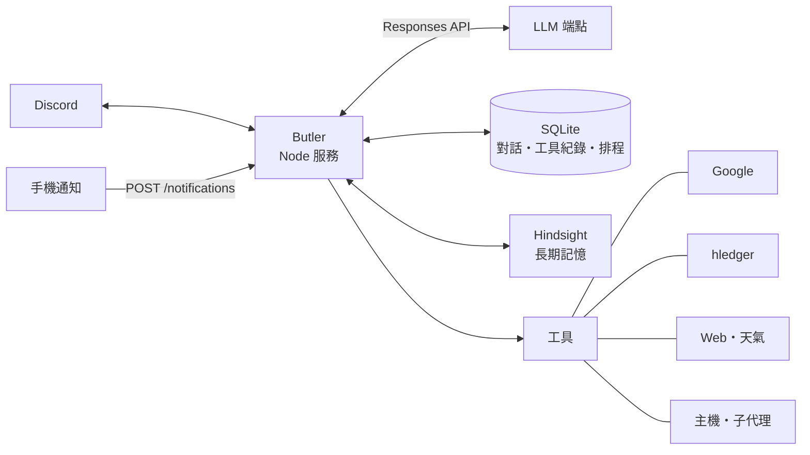

<div align="center">

# Butler

**住在 Discord 裡的個人 AI 助理**

聊天、記帳、看信、排行程、改自己的程式，記得每個頻道說過的事。


[功能](#功能) · [架構](#架構) · [快速開始](#快速開始) · [設定](#設定) · [維運](#維運) · [專案結構](#專案結構)

</div>

## 功能

| | |
|---|---|
| **對話** | 只在 `channels.yaml` 列出的頻道回話，每個頻道一個持久 session；回覆模式可設全部、被提及、不回，訊息可排隊（queue）或插話（steer）；接近模型上限時自動壓縮 |
| **長期記憶** | 選用 [Hindsight](services/hindsight/README.md)，各頻道共用一個記憶庫，每輪自動 recall，另有 `memory_recall`、`memory_reflect`、知識頁 |
| **附件** | 原檔保存，圖片與檔案以原生輸入送給模型，音訊用 Groq Whisper 轉文字 |
| **Google** | Gmail、日曆、Tasks、Drive，多帳號 OAuth |
| **記帳** | hledger 多 posting 分錄、對帳、預算與預測 |
| **網路** | Tavily／AnySearch／Firecrawl 搜尋與擷取，Open-Meteo 天氣，Agent Reach 社群平台唯讀查詢 |
| **主機** | 讀寫檔案、shell、背景程序；`code_execute` 在 QuickJS 沙箱裡串接唯讀工具 |
| **排程** | cron 與一次性提醒，結果送到任何頻道 |
| **子代理** | 把長工作交給 Codex CLI worker，完成後回到原頻道 |
| **生圖** | 一般生圖，以及帶固定外觀參考圖的自拍 |
| **外部通知** | `POST /notifications` 接手機通知，存進 SQLite 後交給指定頻道處理 |
| **自我部署** | 改完程式在聊天裡說一聲就 build、重啟，失敗自動回到上一版 |

> [!WARNING]
> 主機工具不是沙箱，shell 會繼承服務的權限與環境變數。只把 bot 放在信任的伺服器和頻道。

## 架構



- 每則訊息先進該頻道的佇列，組好上下文（人格檔、記憶 recall、歷史、附件）後送給模型，工具迴圈跑完才回覆。
- 原始訊息與每次工具呼叫都記在 SQLite；工具執行前先寫 pending，結果再補上，當機也不會重送寫入操作。
- Hindsight 只當作歷史參考，人格與規則以 `workspace/` 的 Markdown 為準。

## 快速開始

需要 Node.js 24.21.0，以及一個 OpenAI Responses 相容、有 `/models` 的 LLM 端點。Hindsight、hledger 用 Docker 跑，可以不裝。

```sh
npm install
npm run build
mkdir -p .data && cp config.example.yaml .data/config.yaml && chmod 600 .data/config.yaml
# 編輯 .data/config.yaml，至少填 discord.token、discord.ownerId、llm.baseUrl、llm.model
npm run discord:register   # 第一次註冊 slash commands
npm run discord            # 前景啟動，確認能連上
```

Bot 要開 Guilds、GuildMessages、Message Content 三個 intent。

## 設定

| 檔案 | 內容 |
|---|---|
| `.data/config.yaml` | 主設定，欄位見 [`config.example.yaml`](config.example.yaml)；省略的區塊就是停用 |
| `.data/config/channels.yaml` | 要追蹤的頻道與各頻道的回覆模式、模型 |
| `workspace/SOUL.md`、`AGENT.md` | 人格與做事規則 |
| `workspace/OWNER.md`、`MEMORY.md` | 主人資料與共用背景 |

- 大部分設定存檔後熱更新；`discord.token`、`ownerId`、`paths`、`ui`、`google`、memory 啟停要重啟。
- `workspace/` 的四份 Markdown 每個 session 讀一次，改完開新 session 或壓縮後生效。
- `.data/` 與 `workspace/` 都不進版控。

## 維運

Butler 以 systemd unit `butler` 常駐，範本在 [`scripts/butler.service`](scripts/butler.service)，路徑要改成自己的。

```sh
npm start              # 等 Discord ready 才返回
npm run status
npm stop               # 先把進行中的工作做完
npm run deploy         # build 後切換，新版沒 ready 就回到上一版 dist
```

Slash commands：`/status` `/new` `/model` `/img_model` `/mode` `/replymode` `/compact` `/bot_reply` `/restart`

| 路徑 | 內容 |
|---|---|
| `.data/butler.sqlite` | 對話、工具紀錄、排程 |
| `.data/attachments/` | 附件原檔 |
| `.data/finance/` | hledger 帳本 |
| `.data/service/butler.log` | 服務 log |
| `.data/deploy/deploy.log` | 部署 log |

部署不會安裝依賴，依賴有變更要先 `npm install`。更多操作見[維運小抄](docs/yuu_operations.md)。

## 專案結構

```
src/
  main.ts              進入點
  discord.ts           Discord 事件、佇列、slash commands
  agent.ts             組上下文、模型請求與工具迴圈
  store.ts             SQLite
  config.ts            設定載入與熱更新
  hindsight.ts         記憶 API；memory-coordinator.ts 負責 recall 與 retain
  compaction.ts        對話壓縮
  scheduler.ts         排程與提醒
  notifications.ts     外部通知端點
  subagent*.ts         Codex 子代理
  code-mode*.ts        code_execute 沙箱
  *-tools.ts           各類工具
  ui.ts                Google OAuth 管理頁（ui/ 為前端）
scripts/               部署、systemd、快取與 prompt 診斷
services/              hindsight、hledger、alloy 的 Docker 設定
```

## 文件

- [維運小抄：啟停、部署與看 log](docs/yuu_operations.md)
- [Hindsight 服務](services/hindsight/README.md)
- [Hindsight 記憶清空小抄](docs/yuu_hindsight-memory-reset.md)
- [Agent Reach 唯讀工具](docs/agent-reach-tool.md)
